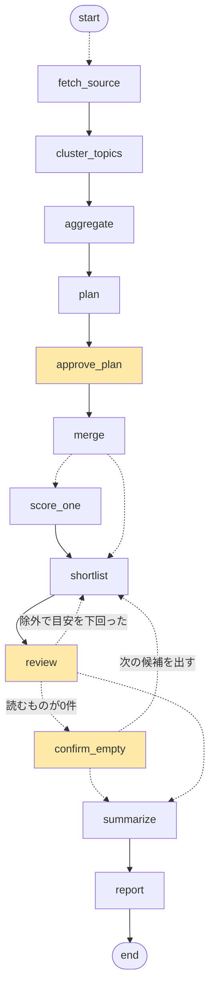

# tsundoku-research-agent

**Tsundoku（積ん読）**: 読むつもりで買った本が、読まれないまま積み上がっていくこと。

Inoreader の「後で読む」に積んだ記事を、週に1回まとめて読める形にする LangGraph エージェントです。

- **まとめる** — 同じ話題を書いた記事を1件にまとめ（埋め込み＋話題キーワード＋固有名詞）、9つのカテゴリに分類して集計する
- **選ぶ** — 関連度・新規性・注目度（各 0〜5、LLM）＋媒体数で採点し、合計点がしきい値以上の話題（20件前後）を提示する
- **人が決める** — 読まないものを除外し、別々になった話題を1つにまとめる（「同じ話題かも」という組み合わせはエージェントが推薦）。保存した記事はすでに自分が選んだものなので、選び直さない
- **要約する** — 読むと決めた話題は本文を取りに行き、同じ話題の記事を横断して 300 字に要約する
- **書く** — 集計・読むもの・全話題・付録・選定の記録を、Markdown と Word の両方で出す

人が介入するのは2か所（計画の確認と、読まないものの除外・話題のまとめ）だけ。途中で止めても、同じ期間を指定すれば続きから再開できます。



黄色が人の承認で止まるノード。`fetch_source` と `score_one` は `Send` で並列に動きます。

## 動かし方

### 1. インストール

Python 3.11 以上。conda でも venv でも動きます。

```bash
git clone https://github.com/nagayoshi3/tsundoku-research-agent.git
cd tsundoku-research-agent

# conda の場合
conda env create -f environment.yml
conda activate tsundoku

# venv の場合
python -m venv .venv && source .venv/bin/activate   # Windows: .venv\Scripts\activate
pip install -e ".[dev]"
```

### 2. まず API キーなしで動かす

サンプル記事と偽 LLM（決定的な採点）で、最後まで通ります。費用はかかりません。

```bash
tsundoku demo
# → ./tsundoku_data/report-weekly-2026-W40.md と .docx ができる
pytest   # 同じ流れを自動テストで確認
```

### 3. 本番

```bash
cp .env.example .env          # OPENAI_API_KEY、INOREADER_APP_ID、INOREADER_APP_KEY を書く
cp config.example.yaml config.yaml   # 関心領域・カテゴリ・重視キーワードを自分用に変える（任意）

tsundoku check-inoreader                 # 初回だけ：Inoreader の認証と、保存日時の意味を確かめる
tsundoku run weekly 2026-10-15           # 10月15日を含む週に保存した記事
tsundoku run weekly 2026-10-15 --fresh   # 同じ週を最初からやり直す（設定や採点方法を変えたとき）
tsundoku run weekly                      # 直近の完了週
tsundoku run monthly 2026-09             # 月次
```

期間は日付（`2026-10-15`）、ISO 週（`2026-W42`）、月（`2026-09`）、`last`、`-1`（1つ前）のどれでも指定できます。

実行すると2か所で止まります。

```
⏸ キーワードと採点件数を確認してください（空 Enter でそのまま承認）
  与えたキーワード: AI agent, agent benchmark, VLA, ...
  ＋ おすすめ: muse wonder — Meta の新モデルの記事が6本あり、エージェント能力の強化が主題
  → 今回のキーワード: ...

⏸ 読まないものがあれば除外してください（何もしなければ全部読む）
  ── AIエージェント ──
   1. [合計13 ＝ 関連度4 ＋ 新規性4 ＋ 注目度4 ＋ 媒体+1] Gemini 4 Argon for Robotics  (DeepMind Blog・同じ話題 +1)
      関連度 4/5: ...
   2. ▸ muse（3話題）  （2 で全部、2a のように枝番で1本だけ除外）
  💡 同じ話題かもしれない組み合わせ（まとめるなら番号を + でつなぐ）:
     3 + 7: Gemini 4 Argon for Robotics ／ DeepMind、ロボット向け Gemini を発表
        cos 0.84 だが見出しの固有名詞が食い違う（argon ／ deepmind）
まとめる番号（+ でつなぐ。例 3+7。まとめると評価と要約も1つになる）>
除外する番号（理由は任意。例 2:既読; 4b; 7）>
```

話題をまとめると、まとめた記事を1つの話題として採点し直し、要約も横断して1つになります（自動のまとめはそのまま。人が足すだけ）。`--yes` を付けると止まらずに提案をそのまま承認します（定期実行向け）。

### 4. Google Colab で

`notebooks/colab_quickstart.ipynb` を開くと、このリポジトリを pip で入れて Google ドライブに保存先を置く形で動きます。チェックポイント（SQLite）はドライブ上で直接読み書きせず、ローカルで動かして止まるたびにドライブへ複製します（ドライブはファイルロックが効かないため）。

## 出力

すべて `--workdir`（既定 `./tsundoku_data`）に残ります。

| ファイル | 中身 |
|---|---|
| `report-weekly-2026-W42.md` / `.docx` | レポート。集計 → 今回読むもの（要約・評価の表） → 全話題（カテゴリ別・採点順） → 付録（読まなかった話題の要約） → 除外と理由 → 選定の記録 |
| `weekly-2026-W42-trace.csv` | 記事1本1行の経路の記録。どの段階（取得／まとめ／代表／採点対象／提示／確定）まで進んだか、点数、基準別の理由、承認②の結果（除外・追加・人がまとめた） |
| `weekly-2026-W42-articles.csv`, `-stats.json` | 記事一覧と集計 |
| `inoreader-inoreader-saved-weekly-2026-W42.json` | Inoreader から取ったままの生データ |
| `log-weekly-2026-W42.txt` | 時刻・経過秒付きの実行ログ |
| `checkpoints.sqlite` | LangGraph のチェックポイント（再開に使う） |

## 設定

`config.yaml`（なければ同梱の `src/tsundoku/default_config.yaml`）。主なもの：

| 項目 | 意味 | 既定 |
|---|---|---|
| `theme` | 関心領域の説明。採点の文脈にだけ使う（絞り込みはしない） | AI 全般 |
| `categories` | 9カテゴリと手がかり語。分類、同じ話題のまとめ、レポートの並びに使う | Physical AI、AIエージェント、RAG・知識活用、LLMモデル動向、学習・適応、効率化・SLM、マルチモーダル、評価・安全性、産業・ビジネス |
| `focus_keywords` | 守備範囲（`theme`）の中で今とくに押し上げたい焦点。関連度の加点と採点に回す順番にだけ効き、分類・まとめには使わない。計画がその週の記事から数語を推薦して足す | 4 語 |
| `shortlist_size` / `shortlist_min_score` | 読む件数の目安／合計点のしきい値（null なら自動：上から目安番目の点） | 20 / null |
| `backfill` | 除外で目安を下回った分を次点で埋める | true |
| `ask_plan` | 承認①で止めるか | true |
| `summary_chars` / `summary_chars_multi` / `summary_scope` | 要約の字数（1本／複数本）／付録まで要約するか（all / selected） | 300 / 400 / all |
| `model` / `embed_model` | LLM と埋め込み（langchain の `init_chat_model` 形式） | gpt-4.1-mini / text-embedding-3-small |
| `price_per_1m_input` / `price_per_1m_output` | LLM の料金（円／100万トークン）。レポートの「選定の記録」に出す費用の目安に使う（埋め込みは含めない）。`model` を変えたら合わせる | 60 / 240 |

API キーは `.env` か環境変数（`OPENAI_API_KEY`、`INOREADER_APP_ID`、`INOREADER_APP_KEY`。任意で `LANGSMITH_API_KEY`）。

## 費用と時間の目安

週 100 話題で、採点・要約・埋め込みを合わせて OpenAI の API 利用が 30〜50 円、所要 5〜8 分（承認の待ち時間を除く）。付録の要約をやめる（`summary_scope: selected`）と 10 円前後・2〜3 分。Inoreader の API は Pro プランが必要です（1日 100 回まで。週 1 回の実行で数回）。

## コードの構成

```
src/tsundoku/
  config.py            設定（config.yaml）、実行時の切り替え、保存先、ログ、API キー
  default_config.yaml  設定の既定値
  prompts.py           計画・採点・固有名詞抽出・要約のプロンプト
  models.py            Candidate / Plan / Score / Summary と LangGraph の State
  llm.py               構造化出力の LLM 呼び出しと、偽 LLM
  guardrails.py        外部の文章を指示として扱わない／出力の実在照合
  periods.py           期間の指定（週・月）の読み替え
  checkpoint.py        SQLite チェックポイントの開閉と複製
  sources/             取得元のレジストリ、サンプルデータ、Inoreader API
  nodes/               グラフのノード：planning, fetch, cluster, aggregate, scoring, review, summarize, report
                       human_merge：承認②で人が話題をまとめる（候補の推薦と、まとめた話題の採点し直し）
  graph.py             配線
  cli.py               対話での実行と承認の入力
  __main__.py          コマンドライン
tests/test_pipeline.py サンプル＋偽 LLM で最後まで通す自動テスト
notebooks/             Colab 用の起動ノートブック
```

設計パターン（Liu ら 2025, *Agent design pattern catalogue*）のうち、Human reflection・Prompt/response optimiser・Tool/agent registry・Agent adapter・Multimodal guardrails・Agent evaluator を使っています。

## ドキュメント

`docs/` に要件定義書と機能要件書（Markdown）があります。

## ライセンス

MIT
